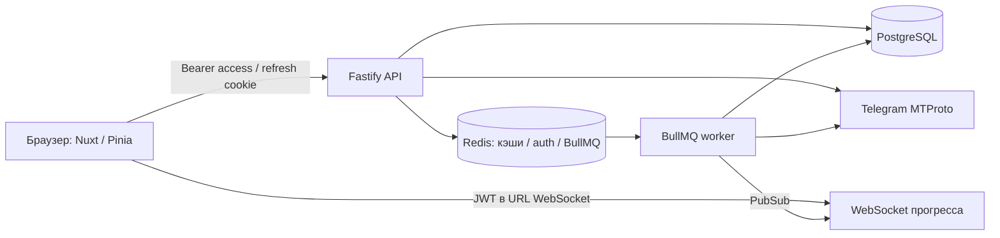

# Аудит TG Analyzer — фаза 0

Дата: 2026-10-06. Исходная точка: `main`, локальные изменения трёх страниц сохранены. Номера строк ниже относятся к исходному коду до исправлений.

## Архитектура и границы доверия

API доверяет подписанному JWT, выборки статистики ограничены userId. Access хранится в localStorage на 30 дней, refresh — HttpOnly cookie на 90 дней; семейства refresh хранятся в PostgreSQL. Постоянные Telegram-сессии шифруются AES-256-GCM, временные сохраняются в Redis открытым JSON. В PostgreSQL записываются агрегаты, слова/эмодзи и имена участников, а не исходные тексты. Worker постранично читает по 100 сообщений, но хранит временную шкалу сообщений в памяти.

## Проверки исходного состояния

- Node 22.14.0, pnpm 10.12.1. `check`, `build`, 8 unit-тестов: успешно (проверено при подготовке плана).
- Сборка: sourcemap warning nuxt:module-preload-polyfill, чанк 825.20 kB (285.79 kB gzip), DEP0155 в зависимостях Nuxt/Vue.
- Docker CLI установлен, Engine первоначально недоступен. Проверка чистой БД, EXPLAIN и полный запуск пока не выполнены. Предпринят запуск Docker Desktop; результаты последующей проверки будут в REPORT.
- README предлагает запускать worker/web дополнительно к `pnpm dev`, хотя scripts/dev.mjs уже запускает все три процесса; это приводит к дублированию.
- `pnpm audit --json`: 9 critical, 58 high, 45 moderate, 15 low (счётчики registry, не число подтверждённых эксплуатируемых путей). Есть advisories без patched_versions. Требуется обновление и анализ достижимости оставшихся.

## Проблемы

| ID / категория | Severity | Источник | Проблема и риск | Исправление / этап |
| --- | --- | --- | --- | --- |
| B1 Безопасность | High | apps/api/src/middleware/auth.middleware.ts:6 | HTTP принимает подписанный WS JWT без проверки назначения | Проверять version/kind/claims/algorithm и живую семью сессии; фаза 1 |
| B2 Безопасность | High | apps/api/src/services/jwt.service.ts:89; apps/web/app/stores/auth.ts:32 | 30-дневный access в localStorage, logout не отзывает его | 15 минут, память браузера, отзыв семьи, разовый перевход; фаза 1 |
| B3 Безопасность | High | apps/api/src/services/telegram.service.ts:99 | Временный sessionString в Redis без шифрования | AES-GCM для всего временного контекста; фаза 1 |
| B4 Безопасность | High | apps/api/src/index.ts:22; apps/api/src/routes/ws.ts:6 | URL с JWT и сырые ошибки могут попадать в лог; нет общего безопасного сериализатора | Редакция, безопасные ошибки, requestId; фаза 1 |
| B5 Безопасность | High | apps/api/src/routes/auth.ts:111; apps/api/src/index.ts:53 | Нет явного CSRF guard для cookie-операций; rate limit только в памяти процесса | Origin guard, Redis rate limit; фаза 1 |
| B6 Приватность | High | apps/api/src/routes/auth.ts:306 | Удаление аккаунта не координируется с worker, очередью и Redis-кэшами | Отзыв и остановка, транзакционная защита записи, очистка; фаза 1 |
| B7 Зависимости | High | pnpm-lock.yaml | Registry сообщает critical/high в Fastify, ORM, Nuxt, Vue и транзитивных зависимостях | Обновить совместимые версии, проверить оставшиеся пути; фаза 1 |
| C1 Конфигурация | High | apps/api/src/config.ts:18 | Boolean coercion превращает строку false в true; нет проверки URL и небезопасных production secrets | Чистый parser, ранний отказ без вывода значений; фаза 1 |
| A1/D1 Данные | High | apps/api/src/services/stats.service.ts:1750,1918,1973 | Отчёт, дневная и общая статистика записываются отдельно; сбой/гонка оставляет рассогласование | Транзакция и блокировка пользователя для save/delete; фаза 1 |
| A2/D2 Очереди | High | apps/api/src/routes/parse.ts:174; apps/api/src/services/session.service.ts:150 | Проверка активной задачи и создание не атомарны; enqueue не восстанавливается после падения | Уникальная активная задача, устойчивые параметры в БД, UUID queue id, reconciliation; фаза 1 |
| A3/F1 Надёжность | High | apps/api/src/workers/parse.worker.ts:288 | failed помечает задачу окончательно неуспешной и снимает блокировку перед retry; отмена может повториться | Терминальные переходы отдельно от попыток; фаза 1 |
| A4/F2 Надёжность | High | apps/api/src/services/telegram.service.ts:255 | GET+DEL/PEXPIRE не атомарны; потеря lease не останавливает клиент | Compare-and-delete/extend Lua, остановка при потере владения; фаза 1 |
| D3 БД | Medium | apps/api/src/db/schema.ts:31,43,372 | Нет уникальности Telegram-сессии и индексов истории/refresh families | Новая миграция с preflight и rollback; фаза 1 |
| F3 Shutdown | High | apps/api/src/workers/index.ts:19 | Redis/PG закрываются одновременно с worker, незавершённые операции теряют хранилище | Последовательное закрытие, ограниченный deadline; фаза 1 |
| A5 Аналитика | Medium | apps/api/src/workers/parse.worker.ts:190; apps/api/src/services/stats.service.ts:1898 | Лимит 500 диалогов; общий top из усечённых top чатов приблизителен | Явный отказ при неполном full parse; точные глобальные top — фаза 2 |
| C2 Качество | Medium | tsconfig.base.json:9; package.json:9 | strict включён, noUncheckedIndexedAccess отсутствует; lint/format отсутствуют; shared не имеет отдельного check | Строгие проверки, ESLint/Prettier, shared check; фаза 1 |
| C3 Архитектура | Medium | apps/api/src/services/stats.service.ts:1; apps/web/app/pages/chat/[id].vue:1 | Крупные модули, аналитика связана с БД; дублирование shared DTO в schema | Только необходимая декомпозиция фазы 1; полноценное разделение — фаза 2 |
| E1 Производительность | Medium | apps/api/src/services/stats.service.ts:509,714; apps/web/app/plugins/echarts.client.ts:1 | Timeline O(n) и сортировка; тяжёлый клиентский чанк | Нагрузочная проверка и потоковая аналитика — фазы 2/5, lazy charts — фаза 3 |
| F4 Эксплуатация | Medium | apps/api/Dockerfile:1; apps/web/Dockerfile:1; docker-compose.yml:1 | Root images, install без frozen lock; dev ports опубликованы; нет CI/backup/runbook | Привязать dev-хранилища к loopback; production упаковка и CI — фаза 4 |
| G1 Тесты | High | apps/api/src/services/session.service.test.ts:1 | Всего 8 тестов, нет интеграционных сценариев auth/queue/rollback | Node test + изолированные PG/Redis + browser сценарий; фаза 1 |
| H1 UI/a11y | Medium | apps/web/nuxt.config.ts:14 | user-scalable=no блокирует zoom; нет подтверждённых viewport/axe/Lighthouse результатов | Дизайн-аудит и исправления фазы 3; текущая фаза не заявляет визуальную приёмку |

Проверены маршруты auth/parse/stats/ws: статистика обычно фильтруется по userId; запасной путь отмены по Redis marker требует дополнительной проверки владельца. Числовые параметры должны быть целыми и безопасными, даты — календарными, с from <= to. Пустые чаты и timezone покрыты частично; DST, повтор страницы и сервисные сообщения требуют регрессий. XSS через v-html в просмотренных компонентах не обнаружен; это не заменяет браузерную проверку.

## Открытые вопросы и безопасные решения

- Production-домены, reverse proxy, резервное копирование неизвестны: не доверять proxy по умолчанию, запрещать wildcard origin в production.
- Telegram-креды не использовать для автоматических тестов: адаптеры только в тестовом окружении, реальный вход проверяется вручную.
- Полный перечень сообщений отсутствует в БД; TTL сейчас очищает историю задач, не отчёты. Не удалять отчёты автоматически без продуктовой политики; задокументировать фактическую политику.
- Для существующих дублей Telegram-сессий миграция должна остановиться с понятным preflight, а не молча удалять данные.

## Порядок работ

1. Опубликовать этот аудит; сохранить пользовательские изменения.
2. Падающие регрессионные тесты, env/auth/приватность и безопасные логи.
3. Миграции, атомарные агрегаты и жизненный цикл задач.
4. Строгая типизация, линтинг, форматирование, проверка зависимостей.
5. Unit/integration/browser, check/build; отчёт с доказательствами и честными ограничениями. К фазам 2–5 не переходить.

## Дополнение: эксплуатация, внешние сервисы и браузерный аудит (2026-10-07)

### Дизайн и доступность

Playwright/Edge запущен на ширинах 360, 390, 768, 1024 и 1280 CSS px; исходные файлы лежат в [`docs/design/before/`](design/before/). На всех пяти размерах маршрут `/login` вернул Nuxt error page с HTTP 500 (`Either manifest or precomputed data must be provided`), а не приложение. Поэтому эти изображения — диагностические свидетельства недоступности рендера, а не визуальные скриншоты продукта. Состояния dashboard/history/chat и интерактивные сценарии браузером не проверены. Дизайн-аудит контраста, реальных tap-targets и responsive-переполнения остаётся открытым до исправного запуска web и тестовой авторизованной сессии.

Подтверждённый UI-риск по исходникам: `apps/web/nuxt.config.ts` ограничивает масштабирование через `maximum-scale=1, user-scalable=no`; следует убрать запрет zoom и проверить увеличение текста. Из-за 500 нельзя достоверно присвоить severity визуальным дефектам раскладки, контраста, фокуса и состояний.

### Чистый запуск и запросы БД

Для проверки использован отдельный временный `docker-compose.test.yml`: PostgreSQL 16 и Redis 7, loopback-порты, PostgreSQL data на `tmpfs`, Redis `maxmemory-policy noeviction`. Пользовательская БД не использовалась. В чистом контейнере `pnpm db:migrate` применил журнал из 8 миграций. `EXPLAIN` подтвердил `parse_jobs_history_idx` для истории задач, `refresh_sessions_family_idx` для выборки семейства refresh и `telegram_sessions_user_idx` для Telegram-сессии. Это планировщик на пустых тестовых таблицах; оценка производительности на репрезентативном объёме и проверка rollback новой миграции не выполнены. Полный production-compose не поднимался. Во время последующей браузерной/параллельной проверки Docker Engine стал недоступен; интеграционные проверки, требующие его, не считать пройденными.

### Дополненные категории риска

| Категория | Наблюдение / риск | Требуемое решение |
| --- | --- | --- |
| Telegram FLOOD_WAIT | Ожидание API может удерживать worker и блокировку; сейчас нет подтверждённой проверки отмены во время ожидания. | Прерываемый sleep с проверкой отмены и lease; ограничить время блокировки, покрыть тестом. |
| Telegram SESSION_REVOKED | Отозванная авторизация должна переводить аккаунт в состояние повторного входа, отзывать/деактивировать сессию и не продолжать запись отчёта. | Единый typed error path для `SESSION_REVOKED`/`AUTH_KEY_UNREGISTERED`; повторная авторизация без утечки деталей. |
| Redis persistence / eviction | Redis одновременно используется для очереди, lock, auth/rate-limit и кэшей. Потеря ключей или eviction может нарушить корректность и защиту от перебора. Тестовый Redis настроен `noeviction`, но production-политика не подтверждена. | Зафиксировать persistence/AOF и backup/restore для BullMQ; отдельное хранилище/лимиты для кэшей; контролировать memory pressure и запретить eviction критичных ключей. |
| Бэкапы / восстановление | Документированный backup и проверенный restore PostgreSQL/Redis в репозитории не обнаружены. | Определить RPO/RTO, шифрованный offsite backup PostgreSQL, процедуру restore и регулярно проверять её; для Redis определить, что восстанавливается из БД и очереди. |
| Healthchecks | API имеет `/health` и `/ready`; готовность зависит в том числе от heartbeat worker. Docker orchestration checks и readiness поведение при недоступных зависимостях требуют интеграционной проверки. | Liveness не должен зависеть от БД; readiness проверяет PostgreSQL/Redis и отдельно worker; задать compose/production healthchecks и таймауты. |
| Sentry / telemetry | Подтверждённой интеграции Sentry не найдено; ошибки могут теряться между API и worker. | Перед интеграцией определить scrubber для cookie, токенов, телефона, кода, пароля, Telegram-сессии, query и job payload; сохранять request/job correlation id. |
| Версионирование API | REST маршруты не имеют версии; DTO shared package развиваются без видимой политики совместимости. | Зафиксировать версионирование `/api/v1` или совместимую политику до внешних клиентов; websocket events тоже версионировать отдельно. |
| Ротация ключа шифрования Telegram | AES-GCM ключ задаётся одним `SESSION_ENCRYPTION_KEY`; нет key id или автоматической ротации старых ciphertext. Простая смена ключа делает сессии нечитаемыми. | Формат envelope с `keyVersion`, чтение несколькими ключами и контролируемый re-encrypt/backfill; не журналировать сессии и ключи. |
| Cross-domain cookie (Vercel + API) | При web на `*.vercel.app` и API на отдельном домене cookie становится cross-site: потребуется `SameSite=None; Secure`, credentialed CORS с точным origin и CSRF guard. Браузерная политика third-party cookies может блокировать cookie даже при верной конфигурации. | Предпочесть same-site custom domains; если невозможны — проверить реальные браузеры, preflight/credentials и CSRF; не использовать wildcard origin/domain. |

### Уточнённые security-решения

- Для B1/B4 websocket не должен принимать access/refresh JWT из URL. Клиент получает access-authenticated `POST /api/auth/ws-ticket`; API выдаёт случайный ticket с TTL около 30 секунд, привязанный к user/session family. WS потребляет его атомарно один раз, проверяет Origin и живость семьи. Ticket всё ещё попадает в query WS handshake, поэтому остаётся короткоживущим секретом: redaction query в access/error logs обязательна.
- Для B2 при старте приложения делать тихий `POST /api/auth/refresh` с HttpOnly cookie и `credentials: include`; access JWT держать только в памяти. На временной сетевой ошибке не показывать ошибку входа до контролируемого восстановления, но не принимать access JWT из localStorage как fallback после reload.
- Одноразовый cutover: новый claim version/kind инвалидирует прежние access/WS токены; refresh-сессии старого формата отозвать миграцией с необратимым `revoked_at`. Пользователям понадобится повторный вход. Миграция должна иметь preflight и не очищать неоднозначные данные автоматически.

### Порядок фаз

1. **1a — безопасность и конфигурация:** token purpose/cutover, refresh cookie и CSRF/origin, rate limit, WS ticket, шифрование временной Telegram-сессии, безопасные ошибки/логи, startup refresh и config validation.
2. **1b — данные, очередь и worker:** атомарные агрегаты, миграции и preflight/rollback, сериализация по пользователю, task reservation/reconciliation, retry/cancel/lease/shutdown и тесты отказов.
3. **1c — качество:** `noUncheckedIndexedAccess`, lint/format, зависимости и удаление мёртвого кода с повторным полным check/build/test.

Для каждой фазы проверять тестами новый риск до исправления. Следующая фаза начинается только после завершения проверок предыдущей; недоступные Docker/browser/Telegram проверки указывать как непроверенные.
